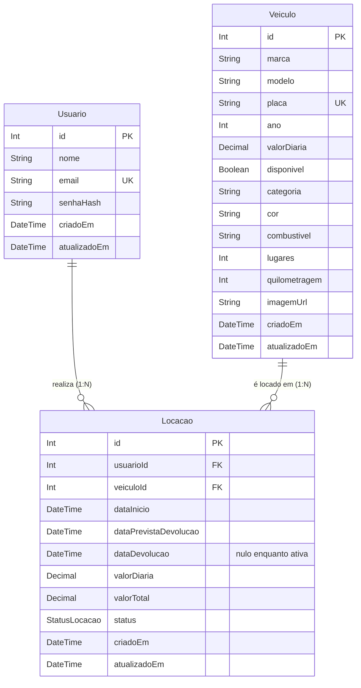
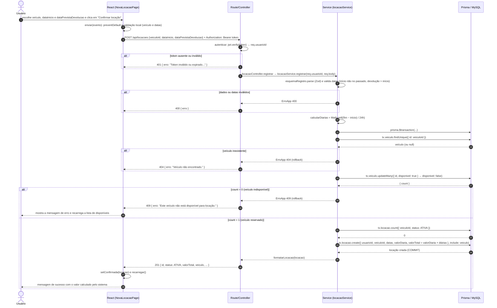

# Guia de apoio — entrega manuscrita individual

> **Este arquivo é só um guia.** O enunciado exige que cada aluno faça **à mão**, em **folhas A4 brancas, sem pautas nem quadriculado**, o DER, o diagrama de sequência e as respostas às cinco questões. Manuscritos digitados e impressos, ou copiados entre integrantes, **não são aceitos**. Use este material para entender o projeto e escreva com as suas próprias palavras.

| Integrante (nome completo, como será escrito na folha) | Assinatura de conferência |
| --- | --- |
| Genilson Pereira ______________________________ | |
| José Carlos ___________________________________ | |
| Matheus Henrique ______________________________ | |

Cada integrante escreve **o próprio nome completo** no topo de **todas** as folhas.

---

## Sugestão de organização das folhas

| Folha | Conteúdo | Orientação |
| --- | --- | --- |
| 1 | DER | A4 **deitada** (paisagem) |
| 2 | Diagrama de sequência — registro de locação | A4 **deitada**; se faltar espaço, use frente e verso |
| 3–4 | Respostas A a E | A4 em pé, uma questão por bloco, com o título de cada letra |

Dicas gerais: lápis para o rascunho e caneta para a versão final; régua para as linhas; letra de forma nos nomes técnicos (`usuarioId`, `locacaoService.registrar`) para não haver dúvida de leitura.

---

## A. Diagrama Entidade-Relacionamento (DER)

O DER deve corresponder exatamente a `backend/prisma/schema.prisma`. Há **três entidades** e **dois relacionamentos 1:N**. O enum `StatusLocacao` (ATIVA, FINALIZADA) é um domínio do atributo `status`, não uma tabela.

### Referência (o que precisa aparecer no papel)



### Como desenhar na folha

```
 ┌──────────────────────┐                                  ┌──────────────────────┐
 │       Usuario        │                                  │       Veiculo        │
 │ (tabela usuarios)    │                                  │ (tabela veiculos)    │
 ├──────────────────────┤                                  ├──────────────────────┤
 │ PK id  Int           │                                  │ PK id  Int           │
 │    nome  VarChar(120)│                                  │    marca VarChar(60) │
 │ UK email VarChar(160)│                                  │    modelo VarChar(60)│
 │    senhaHash         │                                  │ UK placa VarChar(8)  │
 │    criadoEm          │                                  │    ano Int           │
 │    atualizadoEm      │                                  │    valorDiaria Dec   │
 └──────────┬───────────┘                                  │    disponivel Bool   │
            │ 1                                            │    categoria, cor?,  │
            │                                              │    combustivel?,     │
            │ realiza                                      │    lugares, quilom., │
            │                                              │    imagemUrl?        │
            │ N                                            └──────────┬───────────┘
 ┌──────────┴───────────────────────────────┐                         │ 1
 │                Locacao                   │      é locado em        │
 │           (tabela locacoes)              ├─────────────────────────┘
 ├──────────────────────────────────────────┤  N
 │ PK id  Int                               │
 │ FK usuarioId → usuarios.id               │
 │ FK veiculoId → veiculos.id               │
 │    dataInicio  DateTime                  │
 │    dataPrevistaDevolucao  DateTime       │
 │    dataDevolucao  DateTime? (opcional)   │
 │    valorDiaria  Decimal(10,2)            │
 │    valorTotal   Decimal(10,2)            │
 │    status  ATIVA | FINALIZADA            │
 │    criadoEm, atualizadoEm                │
 └──────────────────────────────────────────┘
```

### Checklist do DER

- [ ] Três retângulos com o nome do model (`Usuario`, `Veiculo`, `Locacao`) e, se quiser, o nome da tabela (`usuarios`, `veiculos`, `locacoes`).
- [ ] **PK** marcada em `id` nas três entidades.
- [ ] **FK** marcada em `Locacao.usuarioId` (→ `usuarios.id`) e `Locacao.veiculoId` (→ `veiculos.id`).
- [ ] **UK / único** em `Usuario.email` e `Veiculo.placa`.
- [ ] Cardinalidade **1** do lado de `Usuario` e **N** do lado de `Locacao`; o mesmo entre `Veiculo` e `Locacao` (pé de galinha ou "1" e "N" escritos).
- [ ] `dataDevolucao` marcada como **opcional** (nula enquanto a locação está ativa).
- [ ] `status` com os valores possíveis **ATIVA / FINALIZADA**.
- [ ] Nota curta: "FKs com ON DELETE RESTRICT — histórico preservado".
- [ ] Nome completo do aluno no topo da folha.

---

## B. Diagrama de sequência — Registro de locação

Participantes obrigatórios, da esquerda para a direita: **Usuário**, **React** (`NovaLocacaoPage`), **Route/Controller** (`rotasLocacoes` + `autenticar` + `locacaoController.registrar`), **Service** (`locacaoService.registrar`) e **Prisma/Banco de dados**.

### Referência



### Como desenhar na folha

1. Cinco **linhas de vida** verticais e tracejadas, com o nome de cada participante numa caixa no topo.
2. Setas **cheias** para chamadas e **tracejadas** para respostas; numere as mensagens (1, 2, 3...).
3. Escreva **em cada seta** a operação ou o dado: `POST /api/locacoes + Bearer token`, `jwt.verify`, `findUnique`, `updateMany disponivel=false`, `create`, `201 + valorTotal`.
4. Use **caixas `alt`** (um retângulo com o rótulo "alt" e uma linha tracejada separando os casos) para:
   - **[veículo indisponível]** → `count = 0` → **409** → mensagem de erro na tela (**caminho alternativo obrigatório**);
   - [token inválido] → **401**, e [datas inválidas] → **400**, se couber.
5. Marque com uma chave lateral o trecho dentro de `prisma.$transaction` e escreva "transação: tudo ou nada".

### Checklist do diagrama de sequência

- [ ] Os cinco participantes na ordem pedida.
- [ ] Envio da requisição **com o JWT** no cabeçalho `Authorization`.
- [ ] Validação da autenticação (`autenticar` / `jwt.verify`) e identificação do usuário (`req.usuarioId`).
- [ ] Consulta do veículo (`findUnique`).
- [ ] Verificação de disponibilidade (`updateMany ... disponivel: true`) e das datas.
- [ ] Cálculo do valor (`calcularDiarias` × `valorDiaria`).
- [ ] Persistência (`locacao.create`) e atualização da disponibilidade (`disponivel: false`).
- [ ] Resposta **201** com o `valorTotal` e atualização da interface.
- [ ] **Caminho alternativo**: veículo indisponível → **409** → mensagem na tela.
- [ ] Nome completo do aluno no topo da folha.

---

## C. Questões discursivas

Abaixo estão os pontos que cada resposta precisa conter e um exemplo de resposta. **Não copie o exemplo palavra por palavra**: entenda, consulte o código citado e escreva do seu jeito. O professor pode pedir para você mostrar o trecho no código durante a apresentação.

### A) Responsabilidades de Route, Controller e Service no registro de uma locação

**Pontos obrigatórios:** a Route só mapeia o endereço e aplica o middleware; o Controller lida com HTTP (lê a requisição e devolve status e JSON); o Service concentra as validações e as regras e conversa com o Prisma. Cite os nomes reais.

**Exemplo de resposta:**

> No nosso projeto, o registro de uma locação passa por três camadas. A **Route**, no arquivo `rotas/locacoes.ts`, só diz que a requisição `POST /api/locacoes` deve passar primeiro pelo middleware `autenticar` e depois ir para `locacaoController.registrar`. Ela não tem nenhuma regra.
>
> O **Controller** (`locacaoController.registrar`) é a parte que conhece o HTTP: ele pega o id do usuário que o middleware colocou em `req.usuarioId` e os dados de `req.body`, chama `locacaoService.registrar` e responde com o status **201** e a locação criada em JSON.
>
> O **Service** (`locacaoService.registrar`) é onde está a regra de negócio. Ele valida os dados com o Zod, confere se a data prevista de devolução é posterior à de início, calcula as diárias com `calcularDiarias` e, dentro de uma transação, busca o veículo, marca o carro como indisponível só se ele ainda estiver disponível, confere se não existe outra locação ativa e cria a locação com o valor total. Quando algo dá errado, ele lança um `ErroApp` com o código certo (400, 404 ou 409) e o middleware `tratarErros` transforma isso na resposta.
>
> Assim, se a regra mudar, alteramos só o Service; se o endereço mudar, só a Route.

### B) Relacionamentos 1:N no Prisma, chaves estrangeiras e consulta com include/select

**Pontos obrigatórios:** os dois relacionamentos; os campos de lista (`locacoes Locacao[]`); `@relation(fields, references)` com as FKs `usuarioId` e `veiculoId`; a migration gerou `FOREIGN KEY`; um exemplo de consulta com `include`.

**Exemplo de resposta:**

> Temos dois relacionamentos 1:N. Um usuário pode ter várias locações e cada locação pertence a um só usuário; um veículo pode aparecer em várias locações ao longo do tempo e cada locação é de um só veículo.
>
> No `schema.prisma`, o lado "1" tem um campo de lista: `locacoes Locacao[]` em `Usuario` e em `Veiculo`. O lado "N" é o model `Locacao`, que guarda as chaves estrangeiras `usuarioId` e `veiculoId` e declara as relações assim:
>
> ```prisma
> usuario Usuario @relation(fields: [usuarioId], references: [id])
> veiculo Veiculo @relation(fields: [veiculoId], references: [id])
> ```
>
> Na migration isso virou `FOREIGN KEY (usuarioId) REFERENCES usuarios(id)` e `FOREIGN KEY (veiculoId) REFERENCES veiculos(id)`, com `ON DELETE RESTRICT`, o que impede apagar um usuário ou veículo que tenha histórico.
>
> Para trazer os dados do veículo junto com a locação usamos `include`. Em `locacaoService.listar`:
>
> ```ts
> prisma.locacao.findMany({
>   where: { usuarioId },
>   include: { veiculo: true },
>   orderBy: { criadoEm: 'desc' },
> })
> ```
>
> Com isso cada locação já vem com marca, modelo e placa do carro, e a tela "Minhas locações" mostra essas informações sem precisar de outra requisição.

### C) Fluxo do login e validação do JWT; por que bcrypt; por que não devolver a senha

**Pontos obrigatórios:** `authService.login` → `bcrypt.compare` → `gerarToken` (`jwt.sign` com `sub`); o front guarda o token e envia `Authorization: Bearer`; o middleware `autenticar` faz `jwt.verify` e preenche `req.usuarioId`, ou responde 401; bcrypt gera hash com salt e é lento de propósito; `formatarUsuario` não inclui `senhaHash`.

**Exemplo de resposta:**

> No login, o React envia e-mail e senha para `POST /api/auth/login`. O `authService.login` procura o usuário pelo e-mail e usa `bcrypt.compare` para comparar a senha digitada com o `senhaHash` salvo no banco. Se não bater, responde 401 com a mesma mensagem para e-mail errado e senha errada, para não mostrar quais e-mails existem. Se bater, a função `gerarToken` cria um JWT com `jwt.sign`, colocando o id do usuário no campo `sub`, assinado com o `JWT_SECRET` e com validade definida em `JWT_EXPIRES_IN`.
>
> O frontend guarda esse token na sessão (`iniciarSessao`) e, em toda requisição, a função `requisitar` de `api.ts` envia o cabeçalho `Authorization: Bearer <token>`. Nas rotas protegidas, o middleware `autenticar` separa o "Bearer" do token e chama `jwt.verify`. Se o token não existir, tiver sido alterado ou estiver vencido, ele responde 401. Se estiver certo, grava o id em `req.usuarioId`, e é esse id que o resto da API usa, nunca um id enviado pelo cliente.
>
> Usamos o **bcrypt** porque ele não guarda a senha, e sim um hash com *salt* aleatório. É uma função lenta de propósito (custo 10), o que dificulta ataques de força bruta caso o banco vaze. Também não devolvemos a senha nem o hash nas respostas: a função `formatarUsuario` monta o JSON só com `id`, `nome`, `email` e `criadoEm`. Dado sensível que não é necessário na tela não deve sair da API.

### D) Como impedir duas locações ativas do mesmo veículo e lidar com solicitações simultâneas

**Pontos obrigatórios:** `prisma.$transaction`; `updateMany` com a condição `disponivel: true` (atualização condicional atômica); `count === 0` → 409; a conferência de locações `ATIVA`; o lock de linha do InnoDB faz a segunda requisição esperar; rollback em caso de erro; a finalização usa o mesmo padrão; o teste com 5 requisições em paralelo.

**Exemplo de resposta:**

> A regra fica em `locacaoService.registrar`. Em vez de primeiro ler se o carro está disponível e depois atualizar (duas requisições ao mesmo tempo poderiam ler "disponível"), fazemos tudo dentro de `prisma.$transaction` e usamos uma atualização condicional:
>
> ```ts
> tx.veiculo.updateMany({
>   where: { id: veiculo.id, disponivel: true },
>   data: { disponivel: false },
> })
> ```
>
> No MySQL isso vira um `UPDATE ... WHERE id = ? AND disponivel = true`. Esse comando é atômico: a primeira transação trava a linha do veículo, e uma segunda requisição simultânea fica esperando. Quando a primeira termina, a segunda já encontra `disponivel = false`, o `UPDATE` afeta 0 linhas (`count === 0`) e o service lança `ErroApp(409, 'Este veículo não está disponível para locação.')`. Como garantia extra, ainda dentro da transação conferimos com `tx.locacao.count` que não existe locação `ATIVA` para aquele veículo.
>
> Se qualquer passo falhar, a transação é desfeita (*rollback*), então o carro não fica marcado como indisponível sem uma locação. A finalização segue a mesma ideia com `updateMany({ where: { id, status: 'ATIVA' } })`, o que impede finalizar duas vezes.
>
> Testamos isso disparando 5 requisições ao mesmo tempo para o mesmo veículo: só uma recebe 201 e as outras quatro recebem 409.

### E) Formulário React: estado, eventos e atualização da interface após a resposta da API

**Pontos obrigatórios:** `NovaLocacaoPage`; os estados com `useState` (`veiculoId`, `inicio`, `devolucao`, `erro`, `confirmada`, `enviando`); campos controlados com `value` + `onChange`; `onSubmit={enviar}` com `preventDefault`; `api.criarLocacao` (fetch com token); sucesso → `setConfirmada` + `recarregar()`; erro → `setErro`; o `useRecurso` busca a lista de disponíveis.

**Exemplo de resposta:**

> O formulário fica no componente `NovaLocacaoPage`. Cada campo tem um estado criado com `useState`: `veiculoId` para o carro escolhido, `inicio` e `devolucao` para as datas, além de `erro`, `confirmada` e `enviando` para controlar a tela. Os campos são **controlados**: o `<select>` e os dois `<input type="datetime-local">` recebem o valor do estado em `value` e, no evento `onChange`, chamam `setVeiculoId`, `setInicio` e `setDevolucao`. Assim o React sempre mostra o que está no estado, e o resumo com as diárias e o valor estimado é recalculado a cada mudança.
>
> A lista de veículos vem do hook `useRecurso(api.listarVeiculosDisponiveis, [])`, que chama `GET /api/veiculos/disponiveis`.
>
> Quando o usuário clica em "Confirmar locação", o evento `onSubmit` chama a função `enviar`. Ela usa `evento.preventDefault()` para a página não recarregar, valida os dados localmente e marca `setEnviando(true)`, o que desabilita o botão. Em seguida chama `api.criarLocacao`, que faz um `fetch` para `POST /api/locacoes` com o token no cabeçalho.
>
> Se a API responder 201, guardamos a locação com `setConfirmada(locacao)`, o que mostra a mensagem de sucesso com o **valor total calculado pelo backend**. Também limpamos os campos e chamamos `recarregar()`, que busca de novo os veículos disponíveis, e o carro alugado sai da lista. Se a API responder erro (por exemplo, 409 de veículo indisponível), a mensagem vem em `setErro` e aparece em vermelho, e a lista também é recarregada. No final, `setEnviando(false)` libera o botão.

---

## D. Regras para o manuscrito (do enunciado)

- Folhas **A4 brancas**, **sem pautas e sem quadriculado**.
- Diagramas **inteiramente à mão**; nada impresso ou colado.
- Os diagramas precisam refletir **os nomes, relações e operações reais** do projeto (os deste guia), não modelos genéricos.
- Cada integrante faz o **seu próprio** material; não pode haver cópia entre integrantes.
- **Nome completo** em cada folha; folhas organizadas e legíveis.
- A entrega é **física**, ao professor.
